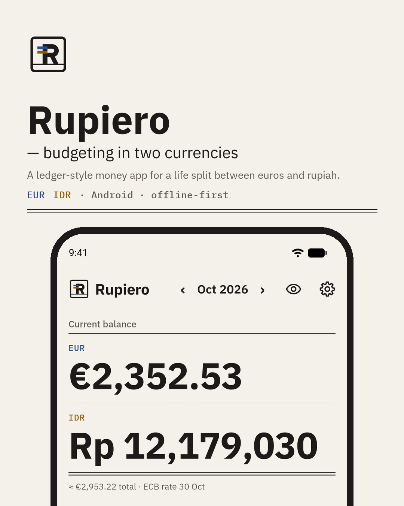
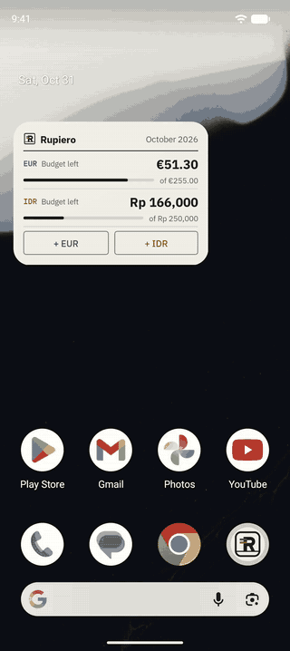

# Rupiero

A ledger-style budgeting app for a life split between euros and rupiah. Android, offline-first, no account.

<p>
  
  &nbsp;
  
</p>

EUR and IDR balances are kept side by side and never mixed. An approximate combined total is shown at the European
Central Bank reference rate, and every transfer records what the conversion actually cost.

## Features

- **Two currencies, never mixed.** One currency per account; balances, budgets and charts are per currency.
  An "≈ total" converts at the latest ECB reference rate and says which day it is from.
- **Quick add in seconds.** A keypad with a built-in calculator (`12.5+3.2` → €15.70), categories ordered by use,
  the last account as default, and a live preview in the other currency.
- **Transfers with the real rate.** Enter what was sent and what arrived; the app shows the implied rate, how far it is
  from that day's ECB rate, and the fee.
- **Budgets per category, month and currency**, with a warning from 80% and red once over; copy from last month.
- **Recurring transactions and subscriptions** (daily, weekly, monthly, yearly, any interval), recorded when due.
- **Charts:** spending by category and a six-month trend, drawn with `react-native-svg`.
- **Home-screen widget** with what is left of this month's budget per currency and one-tap quick add.
- **Privacy in one tap:** hide every amount in the app and, optionally, in the widget.
- **Indonesian and English**, following the phone or chosen in Settings, with locale-aware numbers
  (`€ 2.655,38` / `€2,655.38`) and dates. Light, dark or follow the phone.
- **Accessible:** labels and roles for TalkBack, amounts read out in words, 48 dp touch targets, no clipping at 200% font size.
- **Backups:** JSON export/restore (validated, all-or-nothing) and CSV export for spreadsheets.

## Stack

React Native 0.81 with Expo SDK 54 (new architecture, Hermes) · TypeScript (strict) · SQLite via `expo-sqlite` ·
React Navigation 7 · Reanimated 4 · `@gorhom/bottom-sheet` · `react-native-android-widget` · Jest (320+ tests,
running the real SQL against an in-memory sql.js database).

## Technical decisions

- **Money as integer minor units.** Every amount is a safe integer count of cents (EUR) or rupiah (IDR). Parsing and
  formatting are done by hand, so the output is identical on Hermes and Node, and floats never touch money.
- **BigInt FX.** Only the EUR→IDR reference rate is stored, as an integer `rate_micro` (rate × 10⁶); IDR→EUR is derived.
  Conversions multiply and divide in BigInt and round half-up once at the end, so intermediate products may exceed 2⁵³
  without losing a unit.
- **Transfers keep both amounts.** A transfer stores what left one account and what arrived in the other, plus an
  explicit fee, instead of a rounded rate. The actual rate is derived from the two integers and compared with the ECB rate
  of the transfer date.
- **Versioned migrations with `PRAGMA user_version`.** Each schema version is a migration; all pending steps run in one
  transaction, so a failed upgrade leaves the database untouched. A database newer than the app is refused with an
  explanation instead of being opened.
- **Idempotent recurring transactions.** Occurrences are computed from the start date (n × interval, so the 31st clamps
  to 30 April and returns to the 31st). Materialisation runs on start, on returning to the foreground and in the widget
  task; a unique index on (rule, date) and the rule's `last_generated_date` make it safe to run any number of times.
- **One database connection per process.** The widget task runs in the app's JS runtime and `expo-sqlite` shares
  native connections by name, so the app and the widget share a single connection, and transactions on it are queued.
- **No hard-coded UI text.** All strings go through `src/i18n`; a test walks the TypeScript AST and fails on any
  user-facing literal outside the dictionaries, and another checks that both languages have the same keys and placeholders.

## Running it

Requirements: Node 22, the Android SDK, and an emulator or a device with USB debugging. The app uses native modules
(SQLite, widget, date picker), so it runs as a development build rather than in Expo Go.

```bash
npm install
npx expo run:android      # builds the debug app, installs it and starts Metro
```

In development builds, sample data is added on first launch (turn it off with `EXPO_PUBLIC_SEED_SAMPLE_DATA=false`
in `.env.local`), and Settings has developer tools to reset the database.

Checks:

```bash
npm test
npm run typecheck
npm run lint
```

## Release build

Release builds are signed by a local config plugin (`plugins/with-release-signing.js`) that reads the keystore location
and passwords from Gradle properties outside the repository (`RUPIERO_UPLOAD_*` in `~/.gradle/gradle.properties`).
Without them, the release build falls back to the debug key.

```bash
npx expo prebuild --platform android --no-install
cd android
./gradlew assembleRelease -PreactNativeArchitectures=arm64-v8a
```

Raise `version` and `android.versionCode` in `app.json` for every release so it installs over the previous one
without losing data. [docs/RELEASE.md](docs/RELEASE.md) has the full installation and update guide.

## Project layout

```
src/
  domain/      pure logic: money, dates, FX, calculator, recurrence, budgets (unit-tested)
  db/          schema migrations, repositories, backup/CSV, the shared connection
  i18n/        Indonesian and English dictionaries, locale, spoken amounts
  screens/     one file per screen
  components/  ledger-style UI primitives
  quickadd/    the quick-add sheet
  widget/      home-screen widget data, layout and task handler
plugins/       local Expo config plugins (release signing, widget strings, window background, intents)
modules/       a small local native module (per-app language for native UI)
docs/          research, release guide and showcase material
```

The development history is documented in [PLAN.md](PLAN.md) (phases, decisions and deviations),
[BUDGETAPP_REPORT.md](BUDGETAPP_REPORT.md) (review of the original app) and [docs/RESEARCH.md](docs/RESEARCH.md).
