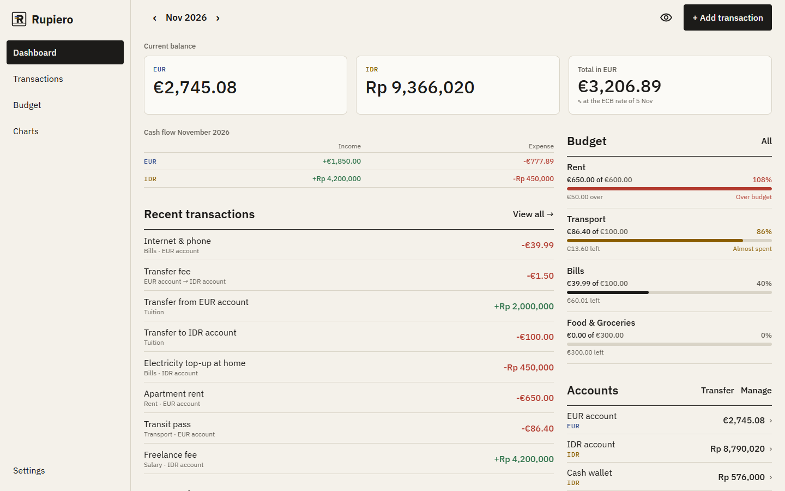
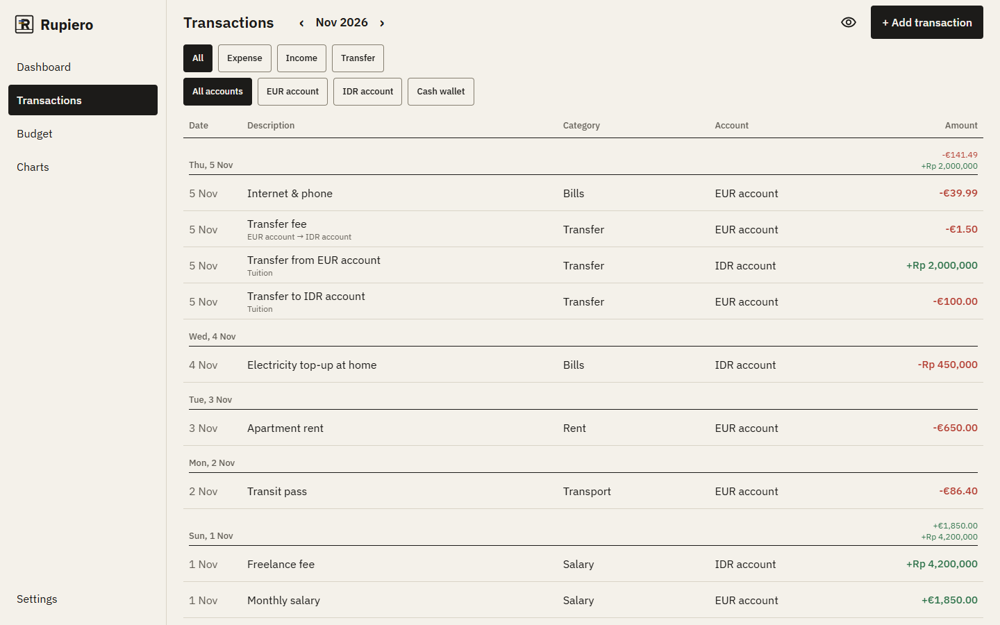
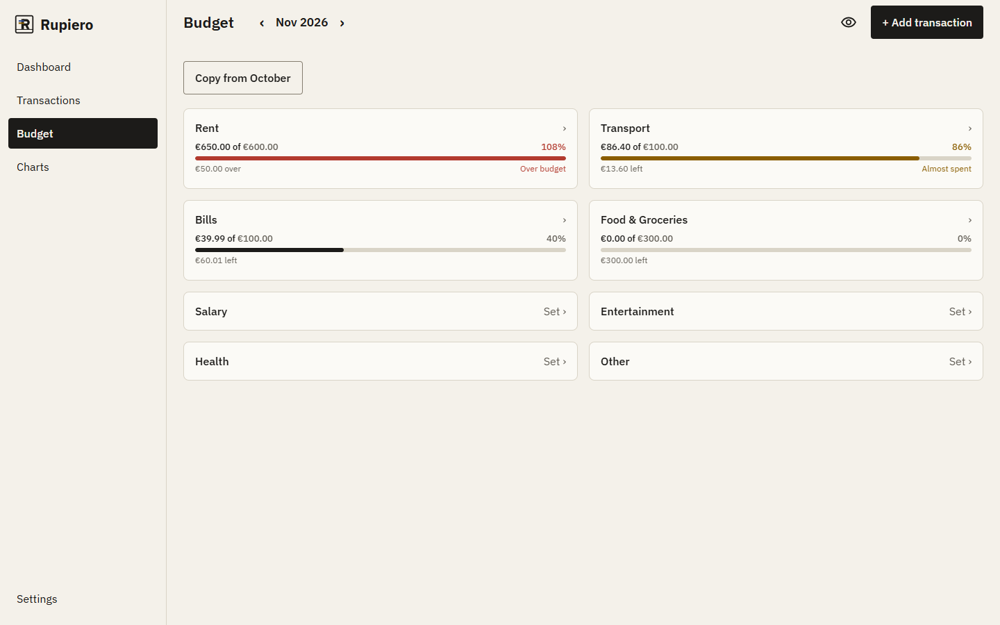
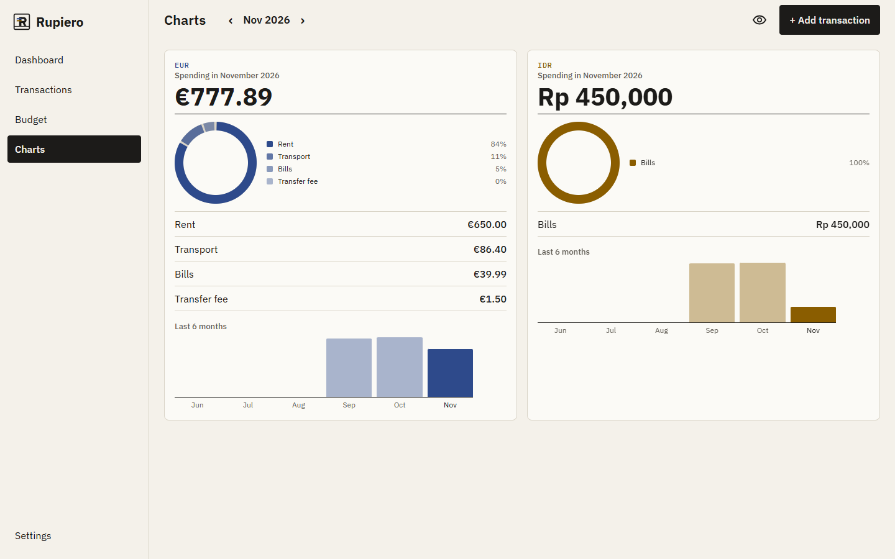
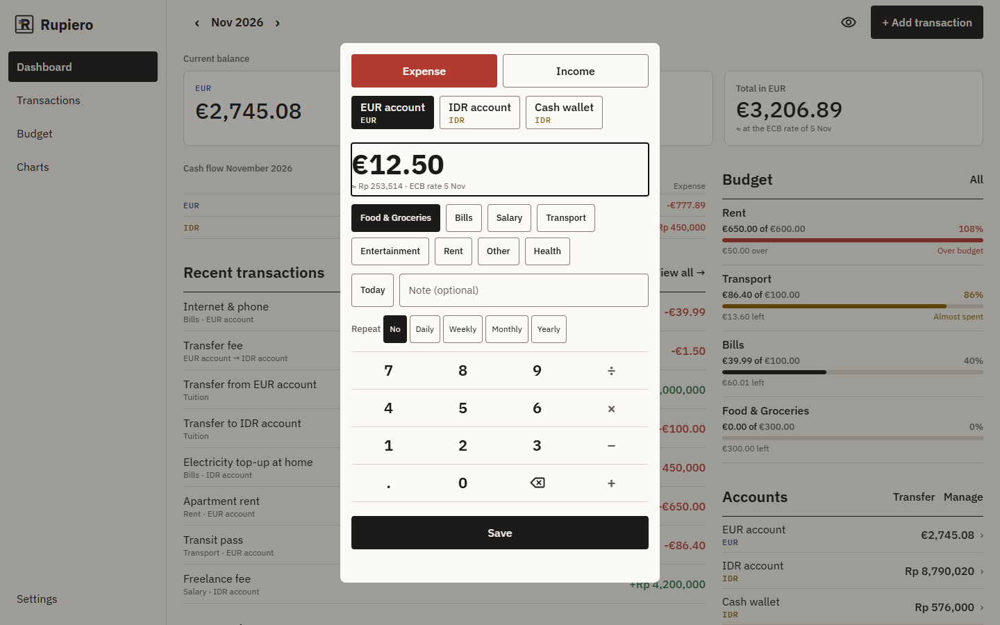
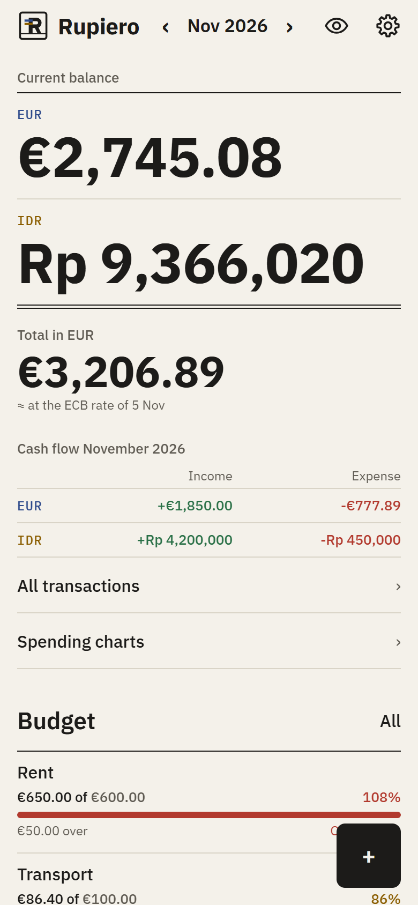

# Rupiero

## What it is

Rupiero is a local-first budgeting web app for people who manage money in both euros and rupiah, like Indonesian
students in France. It keeps the two currencies side by side and shows what they add up to.

**Minimum moment of value:** in under a minute you record one expense in EUR and one in IDR, and the Dashboard shows
both balances plus your total converted into the currency you choose.

Rupiero is an Expo (React Native) app. The same code runs in the browser and on Android. The server only delivers the
app files; your data stays in your browser or on your device, with no account. Exchange rates are the European Central
Bank reference rates, fetched through [Frankfurter](https://frankfurter.dev).

## Features (user stories)

1. **Add income and expenses in EUR or IDR**, so that all my finances are in one place. *(Already existed.)*
2. **See my total balance converted into EUR or IDR**, so that I know how much I really have. *(Built in the demo.)*
3. **A monthly budget per category showing what's left**, so that I don't overspend. *(Already existed.)*
4. **Use Rupiero in the browser, with sample data to try it**, so that I can see what it does without installing anything.
   On a laptop, amounts can be typed on the physical keyboard: Enter saves and Escape closes. *(Built in the demo.)*

Stories 1 and 3 were built before this final project, with Claude Code working through the phases in [PLAN.md](PLAN.md).
Before the demo, the app already showed an approximate total in EUR only. Story 2 adds the choice between EUR and IDR.

**Backlog**
- Date picker on the web (the web build can only record transactions dated today)
- Backup, import and CSV export on web
- Testing in mobile browsers
- Using the app in more than one tab at a time
- A single budget across both currencies (each currency has its own budget today)
- Known issue: on the web, the quick-add note field logs `currentlyFocusedInput is not a function` to the console
  when it loses focus. The error comes from `@gorhom/bottom-sheet`'s `BottomSheetTextInput`, and the note still works.
- Known issue: on the web, screen readers are not told which option is selected in the Settings radio rows
  (language, theme, total balance currency). react-native-web renders them with `role="radio"` but without
  `aria-checked`.

## Screenshots

From the Docker build with sample data (`npm run screenshots` regenerates them).

| Dashboard on a laptop | Transactions as a table |
|---|---|
|  |  |
| **Budget** | **Charts** |
|  |  |
| **Quick-add dialog** | **Dashboard on a phone (390 px)** |
|  |  |

## How to run it

**Requirements:** Docker, or Node 22 for development. The Android SDK is needed only to run on Android.

**Environment variables:** the web build needs none. [`.env.example`](.env.example) lists the optional ones:
`EXPO_PUBLIC_SEED_SAMPLE_DATA` (development only) and `ORG_GRADLE_PROJECT_RUPIERO_UPLOAD_*` (Android release signing only).

**Production (Vercel):** import the repository into Vercel. [`vercel.json`](vercel.json) sets everything else: the
build command `npx expo export -p web`, the output folder `dist`, no framework preset, the rewrite that sends every
route to `index.html`, and the cross-origin isolation and caching headers that expo-sqlite needs.

**Docker** (the same production build on a clean machine, served by nginx):

```bash
docker build -t rupiero-web .
docker run --rm -p 8080:8080 rupiero-web
```

Then open <http://localhost:8080>.

**Development without Docker** (Node 22):

```bash
npm install
npm run web                # Expo dev server for the browser, at http://localhost:8081
npx expo run:android       # or: build and run on an Android emulator or device
```

**Tests:**

```bash
npm test                   # Jest, including the real SQL run against an in-memory database
npm run typecheck
npm run lint
```

**Browser checks** (headless Chrome against the production build, in [`tests/e2e`](tests/e2e)): they need Docker and
Chrome or Chromium. Chrome is found in its usual place; set `CHROME_PATH` if it is installed elsewhere.

```bash
npm run test:e2e:docker    # build the Docker image, run it on port 8095, run every check, stop it (about 8 min)
npm run test:e2e -- http://localhost:8080/    # the same checks against a build that is already running
npm run screenshots        # regenerate docs/screenshots from a fresh Docker build
node tests/e2e/pixels.js <baselineUrl> <url> [sample|budgets]   # pixel-compare phone widths with another build
```

Each check opens its own browser with an empty profile and prints PASS or FAIL per step. Screenshots and pixel diffs
go to `tests/e2e/output/`, which is not committed.

**Public URL:** `https://<project>.vercel.app` *(added after the first Vercel deploy)*

## How it was built with AI

I worked with two AIs, both from Anthropic, and reviewed and approved everything both produced:

- **Claude Code** (the coding agent) was the developer. It read the code, proposed plans, wrote the code and the
  tests, and ran the checks.
- **Claude** (the chat, on claude.ai) was my planning assistant. It helped me choose the project, write the user
  stories, the acceptance criteria and the prompts for Claude Code, research the desktop layout
  ([docs/desktop-web-research.md](docs/desktop-web-research.md)), and decide the deployment: Google Cloud Run
  first, then Vercel, because the course instructor uses it.

My own role was product owner, reviewer and tester: I decided what to build, approved every plan, and tested every
feature before it was merged.

### CLAUDE.md

[CLAUDE.md](CLAUDE.md) is the brief Claude Code reads at the start of every session. The rules that shaped the demo:

- **Branches:** each feature on its own `demo/feature/<name>` branch from `demo/develop`, merged back after my
  check. `master` holds the Android app and is never touched; demo branches are verified on the web only.
- **Scope:** build only what a story's acceptance criteria require; anything else goes to the backlog.
- **Never break Android:** web-only code goes in `.web.tsx` files or behind `Platform.OS` checks, and desktop UI is
  also gated on the 1024 px breakpoint ([ADR 0001](docs/adr/0001-adapt-not-rebuild.md)).
- **Money and data:** integer minor units, BigInt conversion, SQL only in `src/db`, one database connection, and
  every write notifies the screens.
- **Quality:** no hard-coded UI text, colours only from theme tokens, small Conventional Commits that each pass
  typecheck and tests, and no AI attribution in commits.

Rules were added when a session showed they were missing: the desktop-UI rule came with ADR 0001, the web-only rule
for demo branches after an Android test was suggested from a demo branch, and the "headers in both files" rule when
production moved to Vercel.

### PLAN.md phases

Before this final project, Rupiero was rebuilt as an Android app in phases 0 to 5 ([PLAN.md](PLAN.md)): the data
foundation, the "Buku Kas" design system, the Rupiero identity, the core features (quick-add keypad, transfers, ECB
rates), budgets and recurring transactions, the widget, charts and backup, and finally languages and accessibility.
Each phase ended with my test on a phone and a `phase-N-done` tag. Stories 1 and 3 come from that work.

### The workflow for the demo

Every demo feature went through the same loop:

1. **Story and criteria**, written by me, often from human testing ("the keypad feels too mobile on a laptop").
2. **Plan before code.** Claude Code read the relevant code, explained the plan and the files it would touch, and
   waited. Open questions came as explicit options with a recommendation, for example "A: one shared screen list,
   B: leave the Android file untouched".
3. **My approval**, often with changes ("only in the modal", "sorted by percentage used").
4. **Small commits**, each passing typecheck and the Jest suite (now 380 tests).
5. **Checks on the real build:** headless Chrome against the Docker build for the new behaviour, a pixel-by-pixel
   comparison against `demo/develop` at phone widths to prove nothing changed there, and every earlier check again as
   a regression suite (now in [`tests/e2e`](tests/e2e)).
6. **My check, then the merge** into `demo/develop`.

Ten feature branches went through this loop: physical keyboard input, web foundation (fonts and breakpoints), the
base currency, a database fix, the sidebar, sample data and a friendlier second-tab message, the wide Dashboard, the
quick-add dialog, the transactions table, and the Budget and Charts layouts.

### The web feasibility check

The course requires a web app, but Rupiero was an Android app. Before any code changed, I asked Claude Code to check
whether it could run in a browser at all. It built the web version in a scratch copy of the project and tested it in
headless Chrome: the Dashboard rendered, the ECB rate was fetched, and a saved expense was still there after a page
reload and after restarting the browser. It also listed what each native dependency needed on the web. Only then did
the first web commits land on `demo/develop` (4 November):

- **SQLite in the browser:** expo-sqlite runs SQLite as WebAssembly in a Web Worker, stored in the browser's Origin
  Private File System. Metro had to serve `.wasm` files, and every response needs the COOP/COEP headers.
- **Native-only code fenced off:** the Android widget's task handler is registered only on Android, and the theme
  preference goes through `Appearance` only on native.
- **A static production build** (`npx expo export -p web`), served by nginx in Docker with the right headers, so
  every later check ran against what users get.

Then [docs/desktop-web-research.md](docs/desktop-web-research.md) compared adapting the Expo app with rebuilding the
web UI in another framework. [ADR 0001](docs/adr/0001-adapt-not-rebuild.md) records the decision: adapt it, with
web-only layouts for wide screens.

### Real prompts

Three prompts I gave Claude Code, shortened.

**The first demo story**, from human testing. Every feature prompt ended the same way:

> New feature from human testing on web: As a student using Rupiero on a laptop, I want to type amounts with my
> physical keyboard, so that adding a transaction is as fast as in any web app. […] Before writing any code, explain
> your plan and which files you will touch, and wait for my approval. Follow CLAUDE.md and don't add anything outside
> these criteria.

**A database fix with a preferred approach and a way out.** Claude Code found the concrete reason: closing the
database does not release expo-sqlite's file locks, so it ends the database worker instead, and I approved that.

> Web only (.web file): on pagehide, close the SQLite database; on pageshow with event.persisted (restored from the
> back/forward cache), reload the page so it reopens cleanly. Prefer this over reopening the database inside the
> running app, unless you find a concrete reason it doesn't work.

**From research to a rule.** The research became a decision record, and the decision became a rule Claude Code
follows in every session:

> Save the research report below as docs/desktop-web-research.md, and write docs/adr/0001-adapt-not-rebuild.md
> (context, options A/B/C, decision: adapt the Expo app with web-only shell changes, consequences). Add the rule
> "desktop UI only in .web.tsx files or behind Platform.OS === 'web' && wide-breakpoint guards; Android and compact
> web unchanged" to CLAUDE.md.

### What went well

- **Plans caught problems before code.** The latest drawer package would have upgraded the navigation libraries the
  Android app uses; the plan pinned the version that matches instead.
- **"Unchanged on Android and phones" was measured, not promised.** Every change was compared pixel by pixel at 390,
  800 and 1023 px against `demo/develop`, in three data states.
- **Pure logic with unit tests** (the keyboard mapping, budget sorting, the URL config, the ledger text) left the UI
  work as wiring.
- **Small commits and one branch per feature** kept every change reviewable and easy to undo.

### What was hard

- **COOP/COEP headers.** expo-sqlite needs cross-origin isolation, so the server must send
  `Cross-Origin-Opener-Policy` and `Cross-Origin-Embedder-Policy` on every response. In development, Expo CLI serves
  the HTML page before Metro's middleware, so only bundles and assets get the headers there. Production sets them in
  both `docker/nginx.conf` and `vercel.json`.
- **nginx `add_header`.** A `location` block with its own `add_header` drops every `add_header` from the server
  block, so the COOP/COEP headers would vanish on exactly the paths that set caching. The config sets the headers in
  one place and does caching with `expires`.
- **The back/forward cache lock.** Repeated-load tests sometimes showed "could not open … Invalid VFS state". A page
  we had left stayed frozen in the browser's back/forward cache, and its expo-sqlite worker kept the database files
  locked. The web build now ends that worker when the page is hidden and reloads a page restored from the cache. It
  is a workaround tied to expo-sqlite 16.x (`src/db/pageLifecycle.web.ts`), to recheck on every upgrade.
- **Esc while typing the note.** In the bottom sheet, Enter in the note field drops its focus, so a following Esc
  closed the sheet. In the quick-add dialog, react-native-web's `Modal` closes on any Esc in the page, so Esc while
  typing a note would have closed it; the dialog now checks where the focus is first.
- **The keypad felt too mobile.** During human testing on the web, the on-screen keypad felt like a phone app on a
  laptop, so physical keyboard input came first: digits, operators, Enter to save, Esc to close, and later N to open
  quick-add.
- **Checks need checking too.** Many failed checks were mistakes in the test scripts (a non-breaking space inside
  amounts, elements hidden under the navigation stack, a wrong button label). Each failure was investigated before it
  was called a test bug.

## Status and next steps

**What works** (web build, phone and laptop widths):

- All four stories: income and expenses in EUR and IDR, the total in EUR or IDR at the ECB rate, budgets per
  category, and trying the app in the browser with sample data.
- From 1024 px: a sidebar with a URL per section, the Dashboard in cards and a 2:1 grid, transactions in a table,
  Budget and Charts in two columns, quick-add as a dialog, and keyboard input (amounts, Enter, Esc, N).
- Below 1024 px and on Android: the phone layout, unchanged.

**Known limits:**

- **Data stays in one browser.** It is stored in that browser profile only. Another device, another browser, a
  private window or clearing site data each start empty.
- **One tab at a time.** A second tab cannot open the database while the first one is open; it says so and offers to
  try again.
- **expo-sqlite on the web is alpha.** Expo labels its web support as alpha and possibly unstable, and two fixes here
  (`pageLifecycle.web.ts`, `startupRecovery.web.ts`) depend on its current version.
- **Not deployed yet.** The Vercel configuration is ready, but the first deploy and its header check are still to do.

**Backlog:** the list under [Features](#features-user-stories), led by the date picker on the web.

**Natural next step:** deploy to Vercel, check the headers on the preview (`curl -I`), run
`npm run test:e2e -- <preview URL>`, then merge `demo/develop` into `demo/main` for the demo on 13 November. After
the course, the date picker on the web is the most useful missing piece.

---

### Technical notes

- **Stack:** Expo SDK 54, React Native 0.81, TypeScript (strict), SQLite through `expo-sqlite`, React Navigation 7,
  Reanimated 4, `@gorhom/bottom-sheet`, Jest (380 tests) and headless Chrome checks (`tests/e2e`).
- **Money as integer minor units.** Every amount is a whole number of cents (EUR) or rupiah (IDR), and floats never
  hold money. Parsing and formatting are hand-written, so the output is identical on every platform.
- **Conversion in BigInt.** Only the ECB rate from EUR to IDR is stored, as an integer `rate_micro` (rate × 10⁶);
  IDR to EUR is derived from it. Conversions round half-up once, at the end.
- **Transfers keep both amounts.** A transfer stores what left one account, what arrived in the other, and the fee.
  The rate actually paid is derived from those amounts and compared with that day's ECB rate.
- **Versioned migrations** using `PRAGMA user_version`. All pending migrations run in one transaction. A database
  newer than the app is refused instead of being opened.
- **SQLite on the web** runs as WebAssembly in a Web Worker and is stored in the browser's Origin Private File System.
  The server must send `Cross-Origin-Opener-Policy: same-origin` and `Cross-Origin-Embedder-Policy: credentialless`.
- **No hard-coded UI text.** Every string goes through `src/i18n` (English and Indonesian). A test fails on any
  hard-coded string, and another fails if the two languages' keys differ.
- **Layout:** `src/domain` holds pure, tested logic; `src/db` holds migrations and repositories; `src/screens` and
  `src/components` hold the UI; `src/widget` holds the Android home-screen widget.
- **Android release builds:** see [docs/RELEASE.md](docs/RELEASE.md).
- **History:** [PLAN.md](PLAN.md) records the phases, decisions and deviations.
  [BUDGETAPP_REPORT.md](BUDGETAPP_REPORT.md) is the review of the original app.
